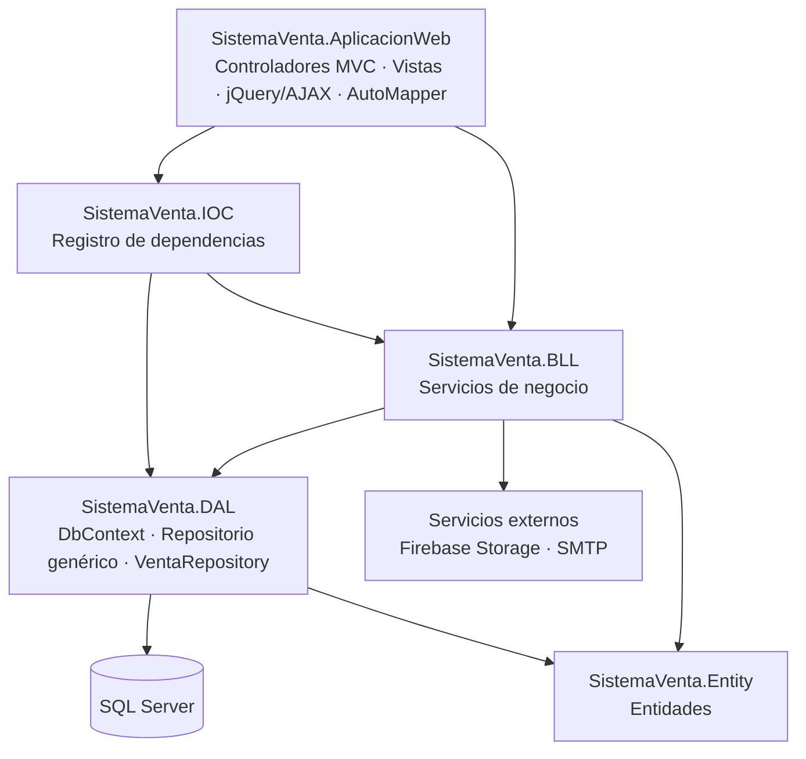

# Sistema de Ventas Web — ASP.NET Core MVC

Aplicación web para gestionar las ventas y el inventario de una tienda: punto de venta, catálogo de productos, usuarios con roles, historial de ventas, reportes y un dashboard semanal.

Construida en **C# / .NET 6** con **ASP.NET Core MVC**, **Entity Framework Core** y **SQL Server**, con una arquitectura en capas que separa la presentación, la lógica de negocio y el acceso a datos.

---

## Funcionalidades

| Módulo | Qué hace |
|---|---|
| **Punto de venta** | Busca productos activos con stock por código de barras, marca o descripción; captura cantidades; calcula subtotal, impuesto y total, y registra la venta con su tipo de documento. |
| **Historial de ventas** | Consulta por número de venta o por rango de fechas, con el detalle de cada venta. |
| **Reportes** | Reporte de ventas por rango de fechas y documentos de venta en PDF generados con DinkToPdf. |
| **Dashboard** | Ventas e ingresos de los últimos 7 días, ventas por día, total de productos y de categorías. |
| **Inventario** | Alta, edición y baja de productos y categorías; las imágenes de los productos se guardan en Firebase Storage. |
| **Usuarios y roles** | Alta de usuarios con contraseña generada y enviada por correo (SMTP), cambio y restablecimiento de contraseña, y menús visibles según el rol. |
| **Negocio** | Datos del negocio (nombre, RFC/documento, logo, porcentaje de impuesto y símbolo de moneda) que se usan en ventas y comprobantes. |

## Arquitectura



- **Entity**: las clases del modelo (`Venta`, `DetalleVenta`, `Producto`, `Usuario`, `Rol`, `Menu`, …).
- **DAL**: `DBVENTAContext` de EF Core, un **repositorio genérico** (`IGenericRepository<T>`) para el CRUD común y un `VentaRepository` específico para la operación de venta.
- **BLL**: un servicio por módulo, cada uno detrás de su interfaz (`IVentaService`, `IProductoService`, `IDashBoardService`, …).
- **IOC**: un método de extensión (`InyectarDependencia`) que registra el `DbContext` y todos los servicios, para que la capa web solo dependa de interfaces.
- **AplicacionWeb**: controladores MVC que exponen endpoints JSON, consumidos desde las vistas con jQuery/AJAX. AutoMapper convierte entre entidades y modelos de vista.

## Registro de una venta

Registrar una venta toca tres tablas, así que todo ocurre dentro de **una sola transacción** (`VentaRepository.Registrar`):

1. Descuenta del stock la cantidad vendida de cada producto.
2. Incrementa el correlativo de ventas y genera el número de venta con relleno de ceros (por ejemplo `000123`).
3. Inserta la venta junto con su detalle.

Si cualquier paso falla, se hace rollback: no quedan ventas a medias, ni stock descontado sin su venta, ni números de venta saltados.

## Tecnologías

- **Backend:** C#, .NET 6, ASP.NET Core MVC, Entity Framework Core 6
- **Base de datos:** SQL Server
- **Frontend:** Razor, JavaScript, jQuery, HTML, CSS
- **Librerías:** AutoMapper, DinkToPdf, FirebaseStorage.net, FirebaseAuthentication.net

## Cómo ejecutarlo

**Requisitos:** Visual Studio 2022, SDK de .NET 6 y SQL Server (Express o Developer).

1. Clona el repositorio y abre `SolucionSistemaVenta.slnx` en Visual Studio.
2. Crea la base de datos `DBVENTA` corriendo el script de la carpeta `Database/` en SQL Server Management Studio.
3. En `SistemaVenta.AplicacionWeb/appsettings.json` ajusta la cadena de conexión `CadenaSQL` a tu servidor:
   ```json
   "ConnectionStrings": {
     "CadenaSQL": "Server=localhost;Database=DBVENTA;Trusted_Connection=True;TrustServerCertificate=True;"
   }
   ```
4. *(Opcional)* Para subir imágenes y enviar correos, llena en la tabla `Configuracion` los recursos `FireBase_Storage` (`api_key`, `email`, `clave`, `ruta`) y `Servicio_Correo` (`correo`, `clave`, `alias`, `host`, `puerto`) con tus credenciales. Las credenciales viven en la base de datos, no en el código.
5. Marca `SistemaVenta.AplicacionWeb` como proyecto de inicio y ejecuta con **F5**.

> DinkToPdf usa la librería nativa `libwkhtmltox`, que debe estar en la carpeta del proyecto web para que se generen los PDF.

## Autor

**Abel Navarro Agudo** — Proyecto académico individual, Ingeniería en Administración de Sistemas, FIME-UANL.
[github.com/Anz-IAS](https://github.com/Anz-IAS)
